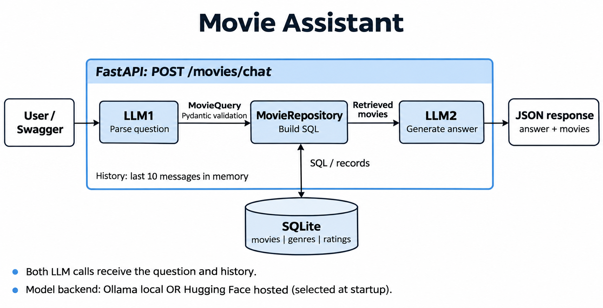

A FastAPI movie assistant using SQLite and a local Ollama or hosted Hugging Face model.

Requires Python 3.11+. Run commands from the project root.

## Setup

Download the [TMDB 5000 dataset](https://www.kaggle.com/datasets/tmdb/tmdb-movie-metadata/data)
and place `tmdb_5000_movies.csv` and `tmdb_5000_credits.csv` in the project root.
The ingestion commands below create or rebuild `tmdb.db`.

### Setup with uv

With uv installed:

```bash
uv sync
uv run python -m pytest -q
uv run python scripts/ingest.py
```

### Setup with pip

Alternatively, create and activate a virtual environment:

```bash
python3 -m venv .venv
source .venv/bin/activate
python -m pip install -r requirements.txt
python -m pytest -q
python scripts/ingest.py
```

## Run locally (default)

Install [Ollama](https://ollama.com/download), then start it in a separate terminal:

```bash
ollama serve
```

Download the default model:

```bash
ollama pull gemma3:4b
```

Start the app using your chosen setup:

```bash
# uv
uv run python -m app.main

# pip, with the virtual environment activated
python -m app.main
```

To use another installed model, set `OLLAMA_MODEL` before starting the app,
for example `export OLLAMA_MODEL='qwen3:4b'`.

## Run with the hosted API

Pass the  --API flag to run against a Hugging Face hosted model. Set your Hugging Face token and a model available to your account that supports
chat and JSON output:

```bash
export HF_TOKEN='your-hugging-face-token'
export HF_MODEL='google/gemma-3-4b-it'
```

Start using your chosen setup

```bash
# uv
uv run python -m app.main --API

# pip, with the virtual environment activated
python -m app.main --API
```

### Try it out
Open http://127.0.0.1:8000/docs to try the API. 
A sample query is in place. To send a new query, amend the ```message``` value in the request_bdoy dictionary:
```json
{
  "conversation_id": "demo",
  "message": "Tell me about Napoleon Dynamite.",
  "reset_history": false
}
```
```json
{
"Answer": "Napoleon Dynamite is a 2004 comedy film about a teenager named Napoleon, starring Jon Heder...."
}
```
```json
{
  "conversation_id": "demo",
  "message": "What else has he starred in?",
  "reset_history": false
}
```
```json
{
  "Answer": "Jon Heder starred in *Beetlejuice* (1988), *The Mary Tyler Moore Show*...."
}
```
The conversation id allows history to be stored for more than one user. The history has a 10 message limit. 
To reset a history for a given user, send a new request with ```"reset_history": true```

The application should be able to answer simple one time queries about movie details, cast or reccomendations, and will hold a history to allow for follow on questions. 
Debugging logs are stored in a file ```log.txt```, to allow the user to investigate what queries the model builds, in the case of incorrect parsing/understanding. 

### WHAT THE APPLICATION DOES

The request flow is:

  User message + recent conversation text
    -> LLM1 interprets the request as MovieQuery
    -> Pydantic validates its structure and values
    -> MovieRepository builds parameterized SQLite queries
    -> LLM2 writes an answer using the retrieved movie records

An unresolved query gets a fixed clarification response. A query returning no
records gets a fixed no-match response. Both skip LLM2.

SQLite stores movie details, genres and aggregate ratings. Cast is stored as a
JSON array of names. A title filter and a cast filter combine with AND.

Conversation history stores the latest ten user/assistant messages. It stores generated 
answer text, not the previous MovieQuery or movie records.
LLM2 sees retrieved cast information, but the next LLM1 call receives it only if
the previous answer happened to mention it.


#### Example problematic Question-Answer case (against local gemma3:4b)
Request 1 -- initial movie question

  User: "Tell me about Napoleon dynamite"
  History: empty.
  LLM1: MovieQuery(intent=details, title="Napoleon Dynamite", year=1986)
  Database: zero matches.
  Response: "I couldn't find matching movies in this dataset. Try a different
  title or fewer filters."

The user supplied a title, not a year. LLM1 invented year=1986, so SQLite searched
for both that title and that year. The stored movie is from 2004. The repository
correctly applied an incorrectly interpreted query; the movie was not missing.
The intended lookup was title only, with year=null and keywords=[].

Request 2 -- repeated movie question

  User: "Tell me about Napoleon dynamite"
  History: the initial question and the no-match response.
  LLM1: MovieQuery(intent=details, title="Napoleon Dynamite", year=2004,
        keywords=["comedy", "high school", "rural", "nerd", "family"].)
  Database: one match, Napoleon Dynamite, TMDb ID 8193.
  LLM2: describes the 2004 film, its school-election plot and family/social life.
  Response: "Napoleon Dynamite is a 2004 comedy film about a teenager named Napoleon who attempts to help his friend win the class presidency. The movie follows his quirky family and social life in a small Idaho town. It's known for its unique humor and memorable characters."

This found the intended movie, but interpretation was still wrong: the model
added a year and five keywords that the user never requested. Those constraints
happened to match. Keyword terms are OR alternatives, so they did not all have
to match for the record to be returned.

The retrieved record included director Jared Hess and cast names Jon Heder, Aaron Ruell and Jon Gries. 
The generated answer did not name an actor.
Only the generated answer was saved for the next turn, so the actor information
did not become part of LLM1's conversation context.


Request 3 -- first actor follow-up, 10:26:03.715 UTC

  User: "what else has he starred in"
  History: four messages, including the movie description above.
  LLM1: query=null, logged as MovieQuery: None.
  Database and LLM2: skipped.
  Response: "Please ask a movie question using a title, genre, director, cast member or release year, or describe a topic using keywords. If this is a follow-up, please name the movie or clarify the filters you want."

This clarification was ok, but could be improved. The saved description mentioned Napoleon,
the character, but did not identify Jon Heder. Under the rule against filling
gaps with model knowledge, LLM1 could not safely identify the actor from its
available text. Asking "Which actor do you mean?" would be a better user-facing
clarification than the current generic reply.

Even passing the previous cast list would not automatically make "he" unique:
the movie has several cast members. Context availability and reference ambiguity
are separate issues.


Request 4 -- repeated actor follow-up, 10:26:15.549 UTC

  User: "what else has he starred in"
  History: six messages, now including the clarification exchange.
  LLM1: intent=search, title="Napoleon Dynamite", cast="Jon Heder".
  Database: one match, Napoleon Dynamite again.
  LLM2: "Jon Heder starred in Beetlejuice (1988), The Mary Tyler Moore Show
        (1974-1977), and Blades of Glory (2007)."

There are two failures here.

First, Jon Heder was absent from the supplied conversation history. The model
apparently supplied his name from its own knowledge; the logs cannot reveal its
internal reasoning. It also retained the original movie title. Searching for
that title AND that actor retrieves the original film, not the actor's filmography.

If the actor had been clearly identified as Jon Heder, the intended query would
have been ```MovieQuery(cast="Jon Heder", title=null and director=null)```. Answering "other movies"
would also require excluding the already discussed film from the final selection.

Second, LLM2 received only the Napoleon Dynamite record, but listed three other
works. Those works and their claimed credits were not supported by the retrieved
record. That is a grounding failure regardless of whether an individual claim
could be true outside this dataset. The fluent response concealed the failure.

##### Timings

Started UTC  | History | LLM1    | Database | LLM2    | Total   | Outcome
-------------|---------|---------|----------|---------|---------|-------------------
10:25:37.987 | 0       | 2.110 s | 3.2 ms   | Skipped | 2.113 s | False no-match
10:25:46.051 | 2       | 1.035 s | 3.2 ms   | 1.935 s | 2.974 s | Movie found
10:26:03.715 | 4       | 0.425 s | Skipped  | Skipped | 0.425 s | Clarification
10:26:15.549 | 6       | 0.681 s | 3.2 ms   | 2.088 s | 2.773 s | Unsupported answer

Total is measured from the logged question to the logged answer. Small gaps
between stage sums and totals reflect application overhead and rounding.
There were no logged provider errors or timeouts. The main issue was correctness,
not database speed. A normally completed request can still contain a bad answer.

##### Why repeating changed the result

Repeated messages were not identical model inputs. Each repeat included more
history, including earlier no-match or clarification replies. Repeating inside
one conversation therefore mixes two factors: changed context and new generation.

The current local parser uses temperature=0.7, so sampling can also contribute
variation. The hosted parser currently requests temperature=0.0. The log does not
record the runtime model, provider or sampling settings, so it cannot establish
which setting caused a particular output. Repetition is not model training.

Prompt simplification and clearer field descriptions may help, but this run does
not demonstrate reliable adherence. The model still added unrequested filters
and retained a title when the request changed to an actor's other movies.

##### What the existing design does and does not guarantee

Pydantic checks permitted fields, types, intents and limits. An invented year can
still be a valid integer. A wrong title or actor can still be a valid string.
Schema-constrained JSON does not establish correct meaning or factual support.

Parameterized SQL keeps data separate from SQL instructions. It faithfully
executes the supplied filters; it cannot identify an unrequested constraint.

The empty-query guard prevents broad retrieval when no criteria were resolved.
It cannot detect a populated but semantically incorrect query.

The logs make these stages inspectable. They let us distinguish no data, bad
interpretation, missing conversational context and unsupported answer generation.
Mocked tests can verify the pipeline and contracts; passing them does not prove
that a real model interprets requests accurately or obeys grounding instructions.

##### Improvements to consider

A. Preserve a little structured reference context.
   Keep the last relevant movie ID/title and necessary cast/director data in the
   existing in-memory conversation state. Supply it to LLM1 as separately labelled
   dataset context, rather than relying on the generated text of the previous answer.
   Do not select the first actor automatically when the user's reference remains ambiguous. No persistent conversation database is needed.

B. Make clarification specific.
   When the unresolved issue is the actor, ask which actor the user means. Giving
   a concise choice from retrieved cast data could help. This may require returning
   a small clarification reason from parsing instead of only query=null.
   Tradeoff: a slightly larger response contract, but a clearer conversation.

C. If using structured answer selection, validate the selected record IDs.
   The model could select IDs from retrieved records; Python would validate the
   selection and insert the actual titles/years. Valid IDs alone would not prove
   that every additional free-text claim is supported. Keep this optional for a POC.

D. Avoid silently deleting filters to make a query succeed.
   Title and cast can both be legitimate user constraints. Automatically clearing
   title whenever cast is present, or retrying after dropping a year, could change
   the user's request and conceal the interpretation error. Any stronger policy
   should be explicit and tied to the supported request type.